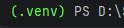

## Startinstruktion finner du [Här](#installera-och-starta-projektet)

---

# Testprojekt – Inlämningsuppgift

## Checklista

### 1. Projekt och GitHub
- [x] Skapa projektet enligt kursens instruktioner
- [x] Initiera Git
- [x] Ladda upp projektet till ett publikt GitHub-repository
- [x] Skapa `README.md`, `STORIES.md` och `ANSWERS.md` i projektets rotmapp

### 2. Backend och testning
- [x] Implementera backend-kod med TDD
- [x] Skriva enhetstester
- [x] Skriva integrationstester
- [x] Verifiera att testerna fungerar

### 3. User stories och BDD
- [x] Dokumentera user stories för befintlig funktionalitet i `STORIES.md`
- [x] Skapa feature-filer utifrån user stories
- [x] Skapa step-filer för samtliga features

### 4. CI – GitHub Actions
- [x] Konfigurera CI för projektet
- [x] Köra samtliga tester automatiskt vid push till `main`
- [x] Köra webbläsartester i headless-läge
- [x] Kontrollera att GitHub Actions-workflowen fungerar

### 5. Dokumentation
- [x] Besvara teorifrågorna i `ANSWERS.md`
- [x] Dokumentera vad som har testats i `README.md`
- [x] Dokumentera hur projektet installeras och startas i `README.md`

### 6. Slutkontroll
- [x] Alla filer finns i projektets rotmapp
- [x] Alla tester körs utan fel
- [x] Alla ändringar är committade och pushade till GitHub
- [x] Repository är publikt
- [x] Projektet är redo för inlämning

---

# Installera och starta projektet
1. Efter att du har klonat projektet saknas den virtuella miljön. Skapa och aktivera den i terminalen:
```
   python -m venv .venv
   .venv\Scripts\activate
```
Funkar inte commandot, skapa en virituell interpreter manuellt, målet är att det skall stå följande i terminalen 


2. Starta med att installera obligatoriska paket som finns noterade i requirements, snabbaste lösning på detta är att skriva ``pip install -r requirements.txt``
 i terminalen samt ``playwright install chromium`` för att installera chromium browser.
3. För att testa alla pytest tester skriv ``pytest`` i terminalen för att starta tester. Önskas isolerade tester av unittester, integration tester eller specifika tester av särskild class, skriv ``pytest -v -m "x"`` men ersätt "x" med någon av de markers som finns [Här](pytest.ini)
4. För att köra Behave testerna skriv ``behave`` i terminalen för att köra alla behave tester. Önskas det köras behave på specifik feature skriv ``behave --tags=x`` men ersätt "x" med någon av följande tags ``katalog``, ``lägg_till_bok`` eller ``mina_böcker``.

## Vad som testats
- **Backend (pytest):** enhetstester och integrationstester för `BookStore`
(`addBook`, `toggleFavorite`) och `FavoriteBooks` (`add`, `remove`).
- **Frontend (behave & playwright):** Tester av vyerna Katalog, Lägg till bok och Mina böcker,
utifrån user stories i `STORIES.md`. Testerna körs headless.